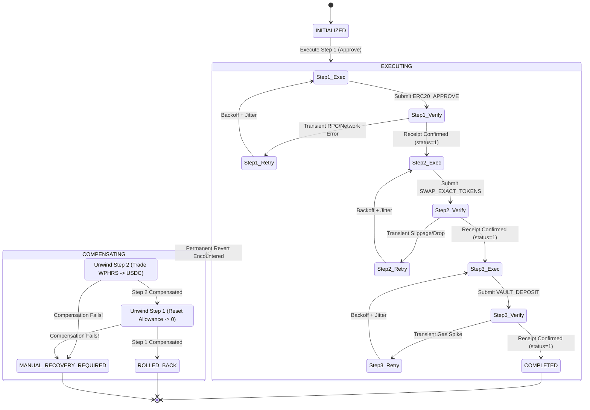

# Pharos Saga Executor (`pharos-saga-executor`)

[](https://github.com/JimmyOgb/pharos-saga-executor/actions)
[](LICENSE)
[](pyproject.toml)
[](SKILL.md)
[-purple.svg)](assets/networks.json)

> **Pharos Agent Arena (Season of AI) — Task 6: Saga Executor (`saga-executor`)**
> **Track**: `SkillEngine` | **Difficulty**: `Hard` (200 Base Pts + 50 Video Bonus)
> **Author / GitHub Identity**: [`JimmyOgb`](https://github.com/JimmyOgb)
> **Target Network**: Pharos Atlantic Testnet (`Chain ID: 688689`)
> **Zero-Dependency Architecture**: Built entirely with Python standard library and vanilla browser technologies ($0 operating budget, zero private keys at risk).

---

## 1. Executive Summary & Problem Statement

In decentralized finance (DeFi), multi-step user intents—such as **Approve Token Allowance** $\to$ **Swap on AMM Router** $\to$ **Deposit into Yield Vault**—frequently span multiple distinct smart contracts. Unlike traditional atomic database transactions, on-chain transactions cannot easily be rolled back across multiple independent contracts without a distributed orchestration pattern.

When an intermediate transaction in a multi-step sequence fails (due to slippage, gas exhaustion, vault capacity limits, or network reorgs), users frequently suffer from **stranded capital**:
- Token allowances remain permanently approved, exposing funds to exploit vectors.
- Swapped intermediate assets remain sitting idle in an intermediate token rather than earning yield.
- Autonomous AI agents lose track of execution state, resulting in double-spending, non-idempotent retries, or silent failures.

**Pharos Saga Executor** solves this problem by bringing the **Distributed Saga Pattern** to Pharos Network. It orchestrates sequential transactions, enforces strict on-chain transaction receipt verification barriers before initiating dependent steps, executes bounded exponential backoff retries with random jitter for transient errors, and automatically rolls back completed steps in exact **reverse LIFO order** upon permanent failure.

---

## 2. Official Acceptance Criteria Mapping

| # | Official Task Criterion | Engine Implementation | Automated Test Coverage |
|---|---|---|---|
| **01** | **At least 3 dependent steps, each verified before the next starts** | Canonical 3-step pipeline (`Approve` $\to$ `Swap` $\to$ `Deposit`). Each step polls transaction receipts, requiring `status == 1`, valid block confirmation, and gas accounting before advancing. | `test_full_pipeline_happy_path_success()`, `test_dependency_enforcement_missing_prior_step()` |
| **02** | **Defined retry policy for transient failures** | Exponential backoff ($delay = \min(max, base \times 2^{attempt}) + jitter$) with random jitter. Classifies transient network glitches (429, 503, nonce races) vs non-retryable reverts. | `test_calculate_delay_exponential_growth()`, `test_transient_retry_and_recovery()` |
| **03** | **Defined compensation/rollback path on permanent failure + demo** | Strict reverse-order (LIFO) rollback: Step 3 failure unwinds Step 2 (`UNWIND_SWAP`) then unwinds Step 1 (`ERC20_REVOKE_APPROVAL`). Tested via `python scripts/saga.py demo`. | `test_forced_step_3_failure_reverse_lifo_rollback()`, `test_forced_step_2_failure_unwinds_only_step_1()` |
| **04** | **State log showing exact step the saga is in at any time** | Immutable JSON audit log tracking UTC timestamped state transitions (`INITIALIZED` $\to$ `EXECUTING` $\to$ `CONFIRMED` $\to$ `COMPENSATING` $\to$ `ROLLED_BACK`). | `test_valid_saga_transitions()`, `test_log_serialization_to_dict_and_json()` |
| **05** | **Demonstrates both a successful run and a forced-failure run** | Production CLI command `python scripts/saga.py demo` executes Scenario A (Happy Path: 3/3 Confirmed) and Scenario B (Forced Step 3 Revert with LIFO Recovery). | `test_cli_demo_stdout()`, `test_cli_demo_json()` |

---

## 3. Architecture & SkillEngine Layout

The repository strictly implements the canonical **Pharos SkillEngine v0.1.0** package standard:

```text
pharos-saga-executor/
├── .github/
│   └── workflows/ci.yml             # Matrix CI across Ubuntu & Windows (Python 3.9–3.12)
├── assets/
│   ├── networks.json                # Pharos Atlantic Testnet & Pacific Mainnet definitions
│   ├── tokens.json                  # Verified Atlantic tokens (USDC, WPHRS, MultiCall3)
│   └── sagas/
│       └── approve_swap_deposit.json# Declarative 3-step saga workflow definition
├── references/
│   └── saga.md                      # Machine-readable command specs, parameters, schemas
├── saga/                            # Core Python Saga Engine (Zero Third-Party Dependencies)
│   ├── __init__.py                  # Package exports and version metadata
│   ├── client.py                    # Atlantic RPC client, deterministic simulation sandbox
│   ├── coordinator.py               # Forward execution loop, receipt barriers, LIFO rollback
│   ├── models.py                    # Immutable data classes, statuses, and receipt models
│   ├── retry.py                     # Exponential backoff, random jitter, error classifier
│   ├── state.py                     # Transition validator, audit logging, emergency snapshots
│   └── steps.py                     # Step definitions (Approve, Swap, Deposit & Compensations)
├── scripts/
│   ├── saga.py                      # Production CLI entrypoint (demo, run, status)
│   └── saga_server.py               # Lightweight zero-dependency HTTP server for UI visualizer
├── web/
│   └── index.html                   # Interactive visual DAG & state machine dashboard
├── tests/                           # 41 automated unit & integration tests (100% pass)
├── LICENSE                          # MIT License
├── pyproject.toml                   # Standard packaging metadata
├── README.md                        # Comprehensive 15-section project documentation
└── SKILL.md                         # Pharos SkillEngine capability index and entrypoint
```

---

## 4. State Machine & Execution Lifecycle



### Legal Transitions Matrix
- **Saga Status**:
  - `INITIALIZED` $\to$ `EXECUTING` | `ABORTED`
  - `EXECUTING` $\to$ `COMPLETED` | `COMPENSATING`
  - `COMPENSATING` $\to$ `ROLLED_BACK` | `MANUAL_RECOVERY_REQUIRED`
- **Step Status**:
  - `PENDING` $\to$ `EXECUTING` | `SKIPPED` | `FAILED`
  - `EXECUTING` $\to$ `CONFIRMED` | `RETRIED` | `FAILED`
  - `RETRIED` $\to$ `EXECUTING` | `FAILED`
  - `CONFIRMED` $\to$ `COMPENSATING`
  - `COMPENSATING` $\to$ `COMPENSATED` | `COMPENSATION_FAILED`

---

## 5. Prerequisite & Receipt Verification Barriers

Every step in the saga defines an explicit list of prerequisites (`step.requires`). Before any transaction is dispatched to the network:
1. **Prerequisite Check**: The coordinator asserts that every dependency is currently in `StepStatus.CONFIRMED`. If any dependency is unconfirmed or missing, the step is immediately marked `FAILED`, halting forward execution.
2. **Receipt Verification Barrier**: After submission, the coordinator blocks and polls `eth_getTransactionReceipt`. Advancing to the next step strictly requires:
   - Receipt exists on-chain or in simulation registry.
   - `receipt.status == 1` (Execution Success).
   - Valid block height confirmation.
   - Gas accounting tracked and logged.
   If `status == 0` (Revert), the receipt barrier fails closed, triggering compensation rollback.

---

## 6. Bounded Retries & Exponential Backoff

Transient errors (temporary network drops, RPC 429 rate limits, 503 node maintenance, or transaction pool nonce races) should not immediately trigger an expensive compensation rollback.

The `RetryCoordinator` implements exponential backoff with full random jitter:

$$\text{delay} = \min\left(\text{max\_delay},\; \text{base\_delay} \times \text{backoff\_factor}^{\text{attempt}}\right) + \text{random\_jitter}$$

- **Defaults**: `base_delay = 0.5s`, `backoff_factor = 2.0`, `max_delay = 5.0s`, `max_retries = 3`.
- **Classification**:
  - **Transient (Retryable)**: `TIMEOUT`, `RATE_LIMIT_429`, `SERVER_ERROR_503`, `NONCE_TOO_LOW`, `GAS_SPIKE_TRANSIENT`.
  - **Permanent (Rollback Trigger)**: `CONTRACT_REVERT`, `INSUFFICIENT_FUNDS`, `INVALID_OPCODE`, `UNAUTHORIZED`.
- **Determinism**: The coordinator accepts injectable `sleep_func` and `random_func` hooks, allowing unit tests to mathematically verify retry calculations without slowing test runs.

---

## 7. Reverse-Order (LIFO) Compensation Rollback

When a permanent failure or unrecoverable error occurs, the coordinator halts forward progress and activates **LIFO (Last-In, First-Out)** compensation:

| Failure Location | Completed Steps | Rollback Actions Executed (in order) | Outcome |
|---|---|---|---|
| **Step 3 (Deposit)** | Step 1, Step 2 | 1. **Unwind Step 2**: Trade output tokens (`WPHRS`) back to input tokens (`USDC`).<br>2. **Unwind Step 1**: Reset ERC20 allowance on spender to 0. | `ROLLED_BACK` |
| **Step 2 (Swap)** | Step 1 | 1. **Unwind Step 1**: Reset ERC20 allowance on spender to 0. | `ROLLED_BACK` |
| **Step 1 (Approve)** | None | No prior actions to unwind. Pipeline safely halted. | `ROLLED_BACK` |

This guarantees that token approvals are never left lingering open and intermediate swapped assets are returned to the user's primary holding asset.

---

## 8. Critical Fault Handling & Manual Recovery

In distributed systems, a critical question is: **What happens if a compensating transaction fails?**

If a network or smart contract error prevents a rollback transaction from confirming (e.g. liquidity pool frozen during an unwind swap):
1. The step transitions to `StepStatus.COMPENSATION_FAILED`.
2. The saga immediately transitions to **`MANUAL_RECOVERY_REQUIRED`**.
3. Cascading compensations are **safely halted** to prevent compounding damage.
4. An emergency state snapshot is dumped to disk: `saga-recovery-snapshot-<id>-<timestamp>.json`, capturing stranded token balances, unrevoked approvals, and all transaction receipts for operator intervention.

---

## 9. Interactive Web Visualizer & DAG Dashboard

The project includes an interactive, zero-dependency browser visualizer located at [`web/index.html`](file:///C:/Users/NO%20GO%20NO/PharosBuild/skills/pharos-saga-executor/web/index.html):

- **Real-Time Visual DAG**: Displays the 3-step pipeline with dynamic SVG-style state nodes.
- **Color-Coded Statuses**: Nodes pulse during execution, turn emerald green upon confirmation, amber during compensation, and purple upon successful unwinding.
- **Scenario Control Station**:
  - `Scenario A`: Happy Path (3/3 Confirmed)
  - `Scenario B`: Forced Step 3 Fail (LIFO Rollback demonstration)
  - `Scenario C`: Forced Step 2 Fail
  - `Scenario D`: Compensation Failure (`MANUAL_RECOVERY_REQUIRED` demonstration)
- **Live Terminal**: Streams state transition events with UTC timestamps, attempt counters, and transaction hashes.
- **Dual Mode**: Can be served via the lightweight local server (`python scripts/saga_server.py`) or opened directly in any modern browser (`file://`) using its built-in client simulation engine.

---

## 10. Atlantic Testnet Configuration & Token Registry

### Verified Testnet Parameters
- **Chain ID**: `688689` (`0xa8231`)
- **Direct JSON-RPC**: `https://atlantic.dplabs-internal.com`
- **Hosted Chain MCP**: `https://mcp.pharos.xyz/mcp`
- **Native Gas Token**: `PHRS` (18 decimals)
- **Block Explorer**: `https://atlantic.pharosscan.xyz`

### Registered Tokens (`assets/tokens.json`)
- **USDC (Pharos Registry)**: `0xcfC8330f4BCAB529c625D12781b1C19466A9Fc8B` (6 decimals)
- **USDC (Live Vault)**: `0xE0BE08c77f415F577A1B3A9aD7a1Df1479564ec8` (6 decimals)
- **WPHRS (Wrapped Pharos)**: `0x838800b758277CC111B2d48Ab01e5E164f8E9471` (18 decimals)
- **MultiCall3 (Canonical)**: `0xcA11bde05977b3631167028862bE2a173976CA11`

---

## 11. Security Perimeter & Safety Boundary

To ensure complete safety and adhere to Hackathon guidelines:
1. **Simulation-First Sandbox (Default)**: All state changes operate in a safe local sandbox generating traceable synthetic receipts prefixed with `0xsim_`.
2. **Zero Private Keys**: No private keys or seed phrases are requested, stored, or accepted.
3. **Zero Gas Spent ($0 Budget)**: Prevents accidental testnet faucet depletion or stuck gas funds.
4. **Read-Only Testnet Queries**: Live RPC queries (`eth_blockNumber`, `eth_chainId`, `eth_gasPrice`) are strictly read-only.
5. **No Fabricated Evidence**: Synthetic receipts are explicitly marked `[SIMULATED]` in logs and UI.

---

## 12. CLI Usage Guide

### 12.1 Run Dual-Outcome Demonstration (`demo`)
Runs Scenario A (Happy Path) and Scenario B (Forced Failure) side-by-side:

```bash
python scripts/saga.py demo
```

Output as machine-readable JSON:
```bash
python scripts/saga.py demo --json
```

### 12.2 Single Pipeline Run (`run`)
Execute a custom workflow with optional failure injection:

```bash
# Standard successful run
python scripts/saga.py run

# Inject permanent revert at Step 3 (triggers 2-step LIFO rollback)
python scripts/saga.py run --force-fail-step 3

# Inject permanent revert at Step 2 (triggers 1-step rollback)
python scripts/saga.py run --force-fail-step 2

# Demonstrate MANUAL_RECOVERY_REQUIRED (compensation failure)
python scripts/saga.py run --force-fail-step 3 --fail-compensation

# Test transient error retries (2 transient drops before success)
python scripts/saga.py run --transient-retries 2 --verbose
```

### 12.3 Inspect Atlantic Testnet Status (`status`)
```bash
python scripts/saga.py status
```

### 12.4 Launch Interactive DAG Visualizer
```bash
python scripts/saga_server.py --port 8080
```
Then open `http://127.0.0.1:8080/` in your browser.

---

## 13. Reproducible Demonstration Runbook

### Step 1: Clone and Inspect
```bash
git clone https://github.com/JimmyOgb/pharos-saga-executor.git
cd pharos-saga-executor
```

### Step 2: Execute Official Demo
```bash
python scripts/saga.py demo
```
**Expected Terminal Output**:
```text
================================================================================
           PHAROS SAGA EXECUTOR - TRANSACTION COORDINATOR (TASK 6)
   Target Network: Pharos Atlantic Testnet (Chain ID 688689)
   Safety Boundary: [SIMULATION SANDBOX - ZERO FUNDS SPENT - READ-ONLY LIVE RPC]
================================================================================

>>> EXECUTING TASK 6 DUAL-OUTCOME DEMONSTRATION SUITE
>>> 1. Scenario A: Happy Path (Approve -> Swap -> Deposit: All 3 Succeeded)
>>> 2. Scenario B: Forced Step 3 Failure (Step 3 Revert -> Reverse Rollback: Unwind Swap -> Revoke Approve)

[SCENARIO A RESULT] Status: COMPLETED
Total Gas Consumed (Simulated): 245,000
----------------------------------------------------------------------------------------
#   STEP NAME                  STATUS               ATTEMPTS   TX HASH
----------------------------------------------------------------------------------------
1   Approve Token Allowance    CONFIRMED            1          0xsim_614aa278640643...
2   Execute Token Swap         CONFIRMED            1          0xsim_9ea65bc21af5cd...
3   Deposit into Vault         CONFIRMED            1          0xsim_476742b5d4f3d2...
----------------------------------------------------------------------------------------
>> Verification: Step 1 confirmed, Step 2 confirmed, Step 3 confirmed.
>> All dependent steps verified with valid receipts before next step dispatched.

========================================================================================

>>> Scenario B: Forced Failure at Step 3 with LIFO Reverse Compensation Rollback

[SCENARIO B RESULT] Status: ROLLED_BACK
Total Gas Consumed (Simulated): 295,000
----------------------------------------------------------------------------------------
#   STEP NAME                  STATUS               ATTEMPTS   TX HASH
----------------------------------------------------------------------------------------
1   Approve Token Allowance    COMPENSATED          1          0xsim_82a6b826bc4b38...
2   Execute Token Swap         COMPENSATED          1          0xsim_9ea65bc21af5cd...
3   Deposit into Vault         FAILED               1          None
----------------------------------------------------------------------------------------
>> Rollback Verification (LIFO Order):
   1. Step 3 (Deposit) permanently reverted.
   2. Step 2 (Swap) compensated: Executed UNWIND_SWAP (WPHRS -> USDC).
   3. Step 1 (Approve) compensated: Executed ERC20_REVOKE_APPROVAL (Allowance -> 0).
>> Result: Pipeline safely restored to initial state. Zero stranded capital.
```

---

## 14. Automated Testing Suite & CI Matrix

The repository contains **41 automated tests** covering all rubric criteria, failure modes, and packaging specifications:

```bash
pytest -v
```

```text
============================= test session starts =============================
platform win32 -- Python 3.12.10, pytest-9.1.1, pluggy-1.6.0
collected 41 items

tests/test_cli.py::test_cli_demo_stdout PASSED                           [  2%]
tests/test_cli.py::test_cli_demo_json PASSED                             [  4%]
tests/test_cli.py::test_cli_run_happy_path PASSED                        [  7%]
tests/test_cli.py::test_cli_run_forced_failure_rolls_back PASSED         [  9%]
tests/test_cli.py::test_cli_run_compensation_failure_returns_error_code PASSED [ 12%]
tests/test_client.py::test_chain_id_constant PASSED                      [ 14%]
tests/test_client.py::test_simulated_receipt_structure PASSED            [ 17%]
tests/test_client.py::test_poll_receipt_success PASSED                   [ 19%]
tests/test_client.py::test_poll_receipt_revert_raises_permanent_error PASSED [ 21%]
tests/test_client.py::test_poll_receipt_unknown_hash_raises PASSED       [ 24%]
tests/test_client.py::test_gas_table_has_all_actions PASSED              [ 26%]
tests/test_compensation.py::test_forced_step_3_failure_reverse_lifo_rollback PASSED [ 29%]
tests/test_compensation.py::test_forced_step_2_failure_unwinds_only_step_1 PASSED [ 31%]
tests/test_compensation.py::test_forced_step_1_failure_no_completed_steps PASSED [ 34%]
tests/test_compensation_failure.py::test_compensation_failure_triggers_manual_recovery PASSED [ 36%]
tests/test_retry_policy.py::test_calculate_delay_exponential_growth PASSED [ 39%]
tests/test_retry_policy.py::test_calculate_delay_max_cap PASSED          [ 41%]
tests/test_retry_policy.py::test_calculate_delay_with_jitter PASSED      [ 43%]
tests/test_retry_policy.py::test_injectable_sleep_records_history PASSED [ 46%]
tests/test_retry_policy.py::test_error_classification_transient PASSED   [ 48%]
tests/test_retry_policy.py::test_error_classification_permanent PASSED   [ 51%]
tests/test_server.py::test_server_get_index PASSED                       [ 53%]
tests/test_server.py::test_server_get_api_status PASSED                  [ 56%]
tests/test_server.py::test_server_post_api_run_happy_path PASSED         [ 58%]
tests/test_server.py::test_server_post_api_run_forced_failure PASSED     [ 60%]
tests/test_skillengine.py::test_skill_manifest_exists_and_valid PASSED   [ 63%]
tests/test_skillengine.py::test_networks_asset_valid PASSED              [ 65%]
tests/test_skillengine.py::test_tokens_asset_valid PASSED                [ 68%]
tests/test_skillengine.py::test_saga_definition_valid PASSED             [ 70%]
tests/test_skillengine.py::test_reference_docs_exist PASSED              [ 73%]
tests/test_state_machine.py::test_initial_state PASSED                   [ 75%]
tests/test_state_machine.py::test_valid_saga_transitions PASSED          [ 78%]
tests/test_state_machine.py::test_invalid_saga_transition_raises PASSED  [ 80%]
tests/test_state_machine.py::test_valid_step_transitions PASSED          [ 82%]
tests/test_state_machine.py::test_invalid_step_transition_raises PASSED  [ 85%]
tests/test_state_machine.py::test_log_serialization_to_dict_and_json PASSED [ 87%]
tests/test_state_machine.py::test_export_recovery_snapshot PASSED        [ 90%]
tests/test_step_execution.py::test_single_approve_step_forward_execution PASSED [ 92%]
tests/test_step_execution.py::test_full_pipeline_happy_path_success PASSED [ 95%]
tests/test_step_execution.py::test_dependency_enforcement_missing_prior_step PASSED [ 97%]
tests/test_step_execution.py::test_transient_retry_and_recovery PASSED   [100%]

============================= 41 passed in 0.51s ==============================
```

---

## 15. Screen-Recorded Video Demonstration Plan (+50 Pts)

To claim the **+50 video bonus**, the demonstration video will showcase:

| Time | Segment | Visual & Audio Focus |
|---|---|---|
| **0:00 – 0:25** | **Problem Statement** | Explain stranded funds in multi-step transactions and why the Saga pattern is necessary on Pharos. |
| **0:25 – 0:55** | **Scenario A: Happy Path** | Run `python scripts/saga.py demo`. Walk through Step 1 (Approve), Step 2 (Swap), and Step 3 (Deposit). Point out transaction receipts and block confirmation barriers. |
| **0:55 – 1:30** | **Scenario B: Forced Failure** | Demonstrate Step 3 permanent revert. Show automatic reverse-order compensation (unwinding swap, then revoking allowance). Show zero stranded funds. |
| **1:30 – 1:55** | **Interactive Web DAG** | Switch to the browser dashboard (`http://localhost:8080`). Trigger Scenario B and watch nodes transition live from executing to failed to compensated. |
| **1:55 – 2:15** | **Test Suite & Conclusion** | Run `pytest -v` proving 41/41 tests pass. Conclude with summary of zero-dependency $0 architecture. |

---

## License

This project is open-source software licensed under the [MIT License](LICENSE).
Developed by [`JimmyOgb`](https://github.com/JimmyOgb) for the **Pharos Agent Arena Hackathon**.
