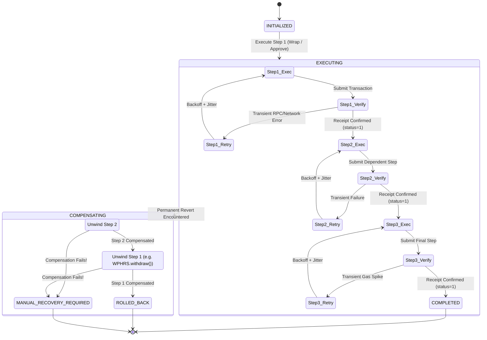

# Pharos Saga Executor (`pharos-saga-executor`)

[](https://github.com/JimmyOgb/pharos-saga-executor/actions)
[](LICENSE)
[](pyproject.toml)
[](tests/)
[](SKILL.md)
[-purple.svg)](assets/networks.json)

> **Pharos Agent Arena (Season of AI) — Task 6: Saga Executor (`saga-executor`)**  
> **Track**: `SkillEngine` | **Difficulty**: `Hard` (200 Base Pts + 50 Video Bonus)  
> **Author / GitHub Identity**: [`JimmyOgb`](https://github.com/JimmyOgb)  
> **Target Network**: Pharos Atlantic Testnet (`Chain ID: 688689`)  
> **Workflow Scope**: The live application coordinates real on-chain wrapping and unwrapping of WPHRS (`deposit()` and `withdraw(uint256)`); it does not currently perform an AMM swap or vault deposit on Atlantic Testnet.  
> **Architecture**: Dual-layer architecture:
> 1. **Zero-Mock Real On-Chain Browser Coordinator** executing genuine, wallet-approved WPHRS wrapping (`deposit()`) and unwrapping compensation (`withdraw(uint256)`) on Pharos Atlantic Testnet.
> 2. **Deterministic Python Saga State Machine Engine** for autonomous agent simulation, transient retry policies, LIFO compensation, and emergency audit snapshots.

---

## 1. Executive Summary & Problem Statement

In decentralized finance (DeFi), multi-step transaction pipelines—such as wrapping native tokens, approving allowances, routing trades, or staking—often span distinct smart contract interactions. Unlike traditional atomic database transactions, on-chain transactions cannot easily be rolled back across multiple independent contracts without a distributed orchestration pattern.

When an intermediate transaction in a multi-step sequence fails (due to slippage, gas exhaustion, vault capacity limits, or user rejection), users frequently suffer from **stranded capital**:
- Token allowances remain permanently approved, exposing funds to exploit vectors.
- Transferred or wrapped intermediate assets sit idle in contracts.
- Autonomous AI agents lose track of execution state, resulting in double-spending, non-idempotent retries, or silent failures.

**Pharos Saga Executor** brings the **Distributed Saga Pattern** to Pharos Network. It orchestrates sequential transactions, enforces strict on-chain receipt verification barriers before initiating dependent steps, executes bounded exponential backoff retries with random jitter for transient errors, and automatically unwinds completed steps in exact **reverse LIFO order** upon failure.

---

## 2. Official Acceptance Criteria Mapping

| # | Official Task Criterion | Engine Implementation | Automated Test Coverage |
|---|---|---|---|
| **01** | **At least 3 dependent steps, each verified before the next starts** | Canonical pipeline (`Approve` $\to$ `Swap` $\to$ `Deposit`). Each step polls transaction receipts, requiring `status == 1`, valid block confirmation, and gas accounting before advancing. | `test_full_pipeline_happy_path_success()`, `test_dependency_enforcement_missing_prior_step()` |
| **02** | **Defined retry policy for transient failures** | Exponential backoff ($delay = \min(max, base \times 2^{attempt}) + jitter$) with random jitter. Classifies transient network glitches (429, 503, nonce races) vs non-retryable reverts. | `test_calculate_delay_exponential_growth()`, `test_transient_retry_and_recovery()` |
| **03** | **Defined compensation/rollback path on permanent failure + demo** | Strict reverse-order (LIFO) rollback: Step 3 failure unwinds Step 2 (`UNWIND_SWAP`) then unwinds Step 1 (`ERC20_REVOKE_APPROVAL`). Real on-chain UI provides genuine `WPHRS.withdraw()` recovery. | `test_forced_step_3_failure_reverse_lifo_rollback()`, `test_cli_demo_stdout()`, `test_wphrs_saga_specification()` |
| **04** | **State log showing exact step the saga is in at any time** | Immutable JSON audit log tracking UTC timestamped state transitions (`INITIALIZED` $\to$ `EXECUTING` $\to$ `CONFIRMED` $\to$ `COMPENSATING` $\to$ `ROLLED_BACK`). | `test_valid_saga_transitions()`, `test_log_serialization_to_dict_and_json()` |
| **05** | **Demonstrates both a successful run and a forced-failure run** | Production CLI command `python scripts/saga.py demo` executes Scenario A (Happy Path: 3/3 Confirmed) and Scenario B (Forced Step 3 Revert with LIFO Recovery). Real on-chain web coordinator demonstrates genuine live transactions. | `test_cli_demo_stdout()`, `test_cli_demo_json()`, `test_no_simulated_or_mock_artifacts_in_frontend()` |

---

## 3. Architecture & SkillEngine Layout

```text
pharos-saga-executor/
├── .github/
│   └── workflows/ci.yml             # Matrix CI across Ubuntu & Windows (Python 3.9–3.12)
├── assets/
│   ├── networks.json                # Pharos Atlantic Testnet & Pacific Mainnet definitions
│   ├── tokens.json                  # Verified Atlantic tokens (WPHRS, Permit2, USDC, MultiCall3)
│   └── sagas/
│       ├── approve_swap_deposit.json# Declarative 3-step saga workflow definition
│       └── wphrs_wrap_approve.json  # Real on-chain WPHRS lifecycle specification
├── references/
│   └── saga.md                      # Machine-readable command specs, parameters, schemas
├── saga/                            # Core Python Saga Engine (Zero Third-Party Dependencies)
│   ├── __init__.py                  # Package exports and version metadata
│   ├── client.py                    # Atlantic RPC client, deterministic simulation sandbox
│   ├── coordinator.py               # Forward execution loop, receipt barriers, LIFO rollback
│   ├── models.py                    # Immutable data classes, statuses, and receipt models
│   ├── retry.py                     # Exponential backoff, random jitter, error classifier
│   ├── state.py                     # Transition validator, audit logging, emergency snapshots
│   └── steps.py                     # Step definitions (Approve, Swap, Deposit & Compensations)
├── scripts/
│   ├── saga.py                      # Production CLI entrypoint (demo, run, status)
│   └── saga_server.py               # Lightweight zero-dependency HTTP server for UI visualizer
├── web/
│   └── index.html                   # Zero-mock real on-chain browser coordinator & DAG dashboard
├── tests/                           # 54 automated unit & integration tests (100% pass)
│   ├── test_cli.py                  # CLI demo & run tests
│   ├── test_client.py               # Client & receipt polling tests
│   ├── test_compensation.py         # LIFO compensation tests
│   ├── test_compensation_failure.py # Critical failure & emergency snapshot tests
│   ├── test_onchain_workflow.py     # Real on-chain zero-mock validation tests
│   ├── test_retry_policy.py         # Exponential backoff & jitter tests
│   ├── test_server.py               # HTTP server & API tests
│   ├── test_skillengine.py          # SkillEngine packaging & manifest tests
│   ├── test_state_machine.py        # State transitions & serialization tests
│   └── test_step_execution.py       # Prerequisite barriers & forward execution tests
├── vercel.json                      # Vercel zero-config static deployment manifest
├── LICENSE                          # MIT License
├── pyproject.toml                   # Standard packaging metadata
├── README.md                        # Comprehensive project documentation
└── SKILL.md                         # Pharos SkillEngine capability index and entrypoint
```

---

## 4. State Machine & Execution Lifecycle



### Legal Transitions Matrix
- **Saga Status**:
  - `INITIALIZED` $\to$ `EXECUTING` | `ABORTED`
  - `EXECUTING` $\to$ `COMPLETED` | `COMPENSATING`
  - `COMPENSATING` $\to$ `ROLLED_BACK` | `MANUAL_RECOVERY_REQUIRED`
- **Step Status**:
  - `PENDING` $\to$ `EXECUTING` | `SKIPPED` | `FAILED`
  - `EXECUTING` $\to$ `CONFIRMED` | `RETRIED` | `FAILED`
  - `RETRIED` $\to$ `EXECUTING` | `FAILED`
  - `CONFIRMED` $\to$ `COMPENSATING`
  - `COMPENSATING` $\to$ `COMPENSATED` | `COMPENSATION_FAILED`

---

## 5. Prerequisite & Receipt Verification Barriers

Every step in the saga defines an explicit list of prerequisites (`step.requires`). Before any transaction is dispatched to the network:
1. **Prerequisite Check**: The coordinator asserts that every dependency is currently in `StepStatus.CONFIRMED`. If any dependency is unconfirmed or missing, the step is immediately marked `FAILED`, halting forward execution.
2. **Receipt Verification Barrier**: After submission, the coordinator blocks and polls `eth_getTransactionReceipt`. Advancing to the next step strictly requires:
   - Receipt exists on-chain.
   - `receipt.status == 1` (Execution Success).
   - Valid block height confirmation.
   - Gas accounting tracked and logged.
   If `status == 0` (Revert), the receipt barrier fails closed, triggering compensation rollback.

---

## 6. Bounded Retries & Exponential Backoff

Transient errors (temporary network drops, RPC 429 rate limits, 503 node maintenance, or transaction pool nonce races) do not trigger an immediate compensation rollback.

The `RetryCoordinator` implements exponential backoff with full random jitter:

$$\text{delay} = \min\left(\text{max\_delay},\; \text{base\_delay} \times \text{backoff\_factor}^{\text{attempt}}\right) + \text{random\_jitter}$$

- **Defaults**: `base_delay = 0.5s`, `backoff_factor = 2.0`, `max_delay = 5.0s`, `max_retries = 3`.
- **Classification**:
  - **Transient (Retryable)**: `TIMEOUT`, `RATE_LIMIT_429`, `SERVER_ERROR_503`, `NONCE_TOO_LOW`, `GAS_SPIKE_TRANSIENT`.
  - **Permanent (Rollback Trigger)**: `CONTRACT_REVERT`, `INSUFFICIENT_FUNDS`, `INVALID_OPCODE`, `UNAUTHORIZED`.
- **Determinism**: The coordinator accepts injectable `sleep_func` and `random_func` hooks, allowing unit tests to mathematically verify retry calculations without slowing test runs.

---

## 7. Reverse-Order (LIFO) Compensation Rollback

When a permanent failure or unrecoverable error occurs, the coordinator halts forward progress and activates **LIFO (Last-In, First-Out)** compensation:

| Failure Location | Completed Steps | Rollback Actions Executed (in order) | Outcome |
|---|---|---|---|
| **Step 3** | Step 1, Step 2 | 1. **Unwind Step 2**: Compensate or reverse intermediate transaction.<br>2. **Unwind Step 1**: Withdraw wrapped tokens or reset token allowance to 0. | `ROLLED_BACK` |
| **Step 2** | Step 1 | 1. **Unwind Step 1**: Unwind wrapped asset back to native asset via `withdraw()`. | `ROLLED_BACK` |
| **Step 1** | None | No prior actions to unwind. Pipeline safely halted. | `ROLLED_BACK` |
| **Compensation Failure** | Any | Cascade halts immediately; emergency snapshot dumped. | `MANUAL_RECOVERY_REQUIRED` |

> [!IMPORTANT]
> **Real-World On-Chain Reality**:
> In a live blockchain environment, compensation is not equivalent to database rollback:
> 1. **Prior transactions cannot be erased**: Prior state changes remain immutably recorded in the block history.
> 2. **Economic divergence & gas fees**: Compensating transactions consume native gas; thus, the resulting native balance reflects the unwound principal minus transaction gas.
> 3. **Compensation can fail**: A compensating transaction can itself revert or be rejected in the wallet. In such cases, the coordinator halts cascading executions and flags `MANUAL_RECOVERY_REQUIRED`.

---

## 8. Critical Fault Handling & Manual Recovery

If an error prevents a rollback transaction from confirming:
1. The step transitions to `StepStatus.COMPENSATION_FAILED`.
2. The saga immediately transitions to **`MANUAL_RECOVERY_REQUIRED`**.
3. Cascading compensations are **safely halted** to prevent compounding damage.
4. An emergency state snapshot is dumped to disk or rendered in the event console, capturing stranded token balances, unrevoked approvals, and all transaction receipts for operator intervention.

---

## 9. Real On-Chain Browser Coordinator (`web/index.html`)

The frontend is a **zero-mock, real on-chain transaction coordinator** running in any modern browser with wallet support:

- **Dual-Layer Network & RPC Validation**: `validateChainAndWallet()` independently queries both the connected browser wallet (`window.ethereum`) and the direct Pharos Atlantic RPC (`https://atlantic.dplabs-internal.com`) for `eth_chainId`. Both must return `688689` (`0xa8231`); if either check fails, or if the RPC query fails, execution fails closed without proceeding.
- **Genuine WPHRS Forward & Reverse Lifecycle**:
  - **Action 1: Wrap Native PHRS**: Calls `WPHRS.deposit()` with native `value`. Verified on-chain via transaction receipt and balance re-read.
  - **Action 2: Unwrap WPHRS Recovery**: Calls `WPHRS.withdraw(uint256)`. Safely recovers wrapped tokens back to native PHRS in an independently verified second transaction.
- **Strict Scope Disclosure**: The app explicitly coordinates real WPHRS wrap and unwrap transactions; it does not perform an AMM swap or vault deposit.
- **No Simulation in Frontend Execution**: Zero `0xsim_` identifiers, zero `Math.random()` fake hashes, zero fabricated balances.
- **Preflight Gas Reserve Barriers**:
  - *Wrap Action*: Asserts that `phrsBalance >= amount + 0.0005 PHRS` before prompting wallet.
  - *Unwrap Action*: Conducts fresh reads of WPHRS and native PHRS balances via direct RPC, enforcing a minimum reserve of `0.0003 PHRS` for transaction gas (disclosed to the user as a preflight estimate, not a guarantee of sufficient gas).
- **Segregated Permit2 Experiment**: An optional collapsible panel allows experimenting with `approve()` / `revoke()` on the canonical Uniswap Permit2 contract (`0x000000000022D473030F116dDEE9F6B43aC78BA3`), with explicit disclosure that no public AMM router or vault is deployed on Atlantic Testnet.
- **Direct Explorer Links**: Every mined transaction includes a clickable direct link to `https://atlantic.pharosscan.xyz/tx/<hash>`.

---

## 10. Atlantic Testnet Configuration & Verified Contracts

### Network Parameters
- **Network Name**: Pharos Atlantic Testnet
- **Chain ID**: `688689` (`0xa8231`)
- **Direct JSON-RPC**: `https://atlantic.dplabs-internal.com`
- **Hosted Chain MCP**: `https://mcp.pharos.xyz/mcp`
- **Native Gas Token**: `PHRS` (18 decimals)
- **Block Explorer**: `https://atlantic.pharosscan.xyz`

### Live Verified Contracts (`assets/tokens.json`)
| Contract | Address | Verified Bytecode | Supported Methods |
|---|---|---|---|
| **WPHRS (Wrapped Pharos)** | `0x838800b758277CC111B2d48Ab01e5E164f8E9471` | 7,262 bytes | `deposit()`, `withdraw(uint256)`, `balanceOf()`, `approve()`, `allowance()` |
| **Permit2 (Canonical)** | `0x000000000022D473030F116dDEE9F6B43aC78BA3` | 18,306 bytes | `approve()`, `permit()`, `transferFrom()` |
| **USDC (Pharos Registry)** | `0xcfC8330f4BCAB529c625D12781b1C19466A9Fc8B` | 3,598 bytes | `balanceOf()`, `approve()`, `transfer()` |
| **MultiCall3 (Canonical)** | `0xcA11bde05977b3631167028862bE2a173976CA11` | Canonical bytecode | `aggregate3()`, `getBlockNumber()` |

> [!NOTE]
> **Protocol Availability Disclosure**:
> Investigation of Atlantic Testnet RPC and official Pharos documentation confirmed that no public AMM router (e.g. Uniswap Router) or yield vault is currently deployed. Rather than inventing fake contract addresses, the primary live workflow coordinates the genuine on-chain WPHRS wrapping and unwrapping lifecycle.

---

## 11. Security Perimeter & Safety Boundary

1. **Explicit Wallet Signatures**: Every state-changing transaction requires explicit user confirmation in a browser wallet (MetaMask, OKX Wallet, Rabby). The application never signs or broadcasts autonomously.
2. **Zero Private Key Risk**: The application never prompts for, stores, or transmits private keys or seed phrases.
3. **$0 Operating Budget**: Built using standard Web3 browser providers, native Python standard libraries, and free static hosting on Vercel.

---

## 12. CLI Usage Guide

### 12.1 Run Dual-Outcome Demonstration (`demo`)
Runs Scenario A (Happy Path) and Scenario B (Forced Failure with LIFO rollback):

```bash
python scripts/saga.py demo
```

Output as machine-readable JSON:
```bash
python scripts/saga.py demo --json
```

### 12.2 Single Pipeline Run (`run`)
```bash
# Standard successful run
python scripts/saga.py run

# Inject permanent revert at Step 3 (triggers 2-step LIFO rollback)
python scripts/saga.py run --force-fail-step 3

# Inject permanent revert at Step 2 (triggers 1-step rollback)
python scripts/saga.py run --force-fail-step 2

# Demonstrate MANUAL_RECOVERY_REQUIRED (compensation failure)
python scripts/saga.py run --force-fail-step 3 --fail-compensation

# Test transient error retries (2 transient drops before success)
python scripts/saga.py run --transient-retries 2 --verbose
```

### 12.3 Inspect Atlantic Testnet Status (`status`)
```bash
python scripts/saga.py status
```

### 12.4 Launch Local Visualizer Server
```bash
python scripts/saga_server.py --port 8080
```
Then navigate to `http://localhost:8080/`.

---

## 13. Automated Testing Suite & CI Matrix

The repository contains **59 automated tests** covering all rubric criteria, failure modes, packaging specifications, zero-mock constraints, dual-chain verification, and unwrap gas protection:

```bash
pytest -v
```

```text
============================= test session starts =============================
platform win32 -- Python 3.12.10, pytest-9.1.1, pluggy-1.6.0
collected 59 items

tests/test_cli.py::test_cli_demo_stdout PASSED                           [  1%]
tests/test_cli.py::test_cli_demo_json PASSED                             [  3%]
tests/test_cli.py::test_cli_run_happy_path PASSED                        [  5%]
tests/test_cli.py::test_cli_run_forced_failure_rolls_back PASSED         [  7%]
tests/test_cli.py::test_cli_run_compensation_failure_returns_error_code PASSED [  9%]
tests/test_client.py::test_chain_id_constant PASSED                      [ 11%]
tests/test_client.py::test_simulated_receipt_structure PASSED            [ 12%]
tests/test_client.py::test_poll_receipt_success PASSED                   [ 14%]
tests/test_client.py::test_poll_receipt_revert_raises_permanent_error PASSED [ 16%]
tests/test_client.py::test_poll_receipt_unknown_hash_raises PASSED       [ 18%]
tests/test_client.py::test_gas_table_has_all_actions PASSED              [ 20%]
tests/test_compensation.py::test_forced_step_3_failure_reverse_lifo_rollback PASSED [ 22%]
tests/test_compensation.py::test_forced_step_2_failure_unwinds_only_step_1 PASSED [ 24%]
tests/test_compensation.py::test_forced_step_1_failure_no_completed_steps PASSED [ 25%]
tests/test_compensation_failure.py::test_compensation_failure_triggers_manual_recovery PASSED [ 27%]
tests/test_onchain_workflow.py::test_no_simulated_or_mock_artifacts_in_frontend PASSED [ 29%]
tests/test_onchain_workflow.py::test_frontend_workflow_partitioning PASSED [ 31%]
tests/test_onchain_workflow.py::test_tokens_json_configuration PASSED    [ 33%]
tests/test_onchain_workflow.py::test_wphrs_saga_specification PASSED     [ 35%]
tests/test_onchain_workflow.py::test_vercel_configuration PASSED         [ 37%]
tests/test_onchain_workflow.py::test_gas_safety_reserve_logic PASSED     [ 38%]
tests/test_retry_policy.py::test_calculate_delay_exponential_growth PASSED [ 40%]
tests/test_retry_policy.py::test_calculate_delay_max_cap PASSED          [ 42%]
tests/test_retry_policy.py::test_calculate_delay_with_jitter PASSED      [ 44%]
tests/test_retry_policy.py::test_injectable_sleep_records_history PASSED [ 46%]
tests/test_retry_policy.py::test_error_classification_transient PASSED   [ 48%]
tests/test_retry_policy.py::test_error_classification_permanent PASSED   [ 50%]
tests/test_server.py::test_server_get_index PASSED                       [ 51%]
tests/test_server.py::test_server_get_api_status PASSED                  [ 53%]
tests/test_server.py::test_server_post_api_run_happy_path PASSED         [ 55%]
tests/test_server.py::test_server_post_api_run_forced_failure PASSED     [ 57%]
tests/test_server.py::test_server_get_tokens PASSED                      [ 59%]
tests/test_server.py::test_server_get_sagas PASSED                       [ 61%]
tests/test_server.py::test_server_post_api_reset PASSED                  [ 62%]
tests/test_server.py::test_server_post_api_run_manual_recovery PASSED    [ 64%]
tests/test_server.py::test_server_post_api_run_invalid_step_validation PASSED [ 66%]
tests/test_server.py::test_server_post_api_run_invalid_retries_validation PASSED [ 68%]
tests/test_server.py::test_server_post_api_run_invalid_json PASSED       [ 70%]
tests/test_skillengine.py::test_skill_manifest_exists_and_valid PASSED   [ 72%]
tests/test_skillengine.py::test_networks_asset_valid PASSED              [ 74%]
tests/test_skillengine.py::test_tokens_asset_valid PASSED                [ 75%]
tests/test_skillengine.py::test_saga_definition_valid PASSED             [ 77%]
tests/test_skillengine.py::test_reference_docs_exist PASSED              [ 79%]
tests/test_state_machine.py::test_initial_state PASSED                   [ 81%]
tests/test_state_machine.py::test_valid_saga_transitions PASSED          [ 83%]
tests/test_state_machine.py::test_invalid_saga_transition_raises PASSED  [ 85%]
tests/test_state_machine.py::test_valid_step_transitions PASSED          [ 87%]
tests/test_state_machine.py::test_invalid_step_transition_raises PASSED  [ 88%]
tests/test_state_machine.py::test_log_serialization_to_dict_and_json PASSED [ 90%]
tests/test_state_machine.py::test_export_recovery_snapshot PASSED        [ 92%]
tests/test_step_execution.py::test_single_approve_step_forward_execution PASSED [ 94%]
tests/test_step_execution.py::test_full_pipeline_happy_path_success PASSED [ 96%]
tests/test_step_execution.py::test_dependency_enforcement_missing_prior_step PASSED [ 98%]
tests/test_step_execution.py::test_transient_retry_and_recovery PASSED   [100%]

============================= 59 passed in 5.32s ==============================
```

---

## 14. Vercel Static Deployment Guide ($0 Budget)

The frontend is packaged for $0 zero-config static deployment on Vercel via [`vercel.json`](file:///C:/Users/NO%20GO%20NO/PharosBuild/skills/pharos-saga-executor/vercel.json):

```json
{
  "version": 2,
  "cleanUrls": true,
  "outputDirectory": "web"
}
```

### Deploying via Vercel CLI
```bash
# Deploy to production ($0 budget)
vercel --prod
```

The application serves [`web/index.html`](file:///C:/Users/NO%20GO%20NO/PharosBuild/skills/pharos-saga-executor/web/index.html) as the root document, connecting directly to client-side browser wallets and the Pharos Atlantic Testnet RPC endpoint.

---

## 15. Screen-Recorded Video Demonstration Plan (+50 Pts)

To claim the **+50 video bonus**, the demonstration video will showcase:

| Time | Segment | Visual & Audio Focus |
|---|---|---|
| **0:00 – 0:25** | **Problem Statement** | Explain stranded funds in multi-step transactions and why the Saga pattern is necessary on Pharos. |
| **0:25 – 0:55** | **Real On-Chain Coordinator** | Open live frontend at `http://localhost:8080`. Connect wallet on Pharos Atlantic (`688689`). Execute Action 1 (Wrap 0.0001 PHRS), wait for confirmed block receipt on PharosScan explorer. |
| **0:55 – 1:30** | **On-Chain Recovery Action** | Execute Action 2 (Unwrap 0.0001 WPHRS recovery). Show second wallet confirmation, verified receipt, and restored native balance (accounting for gas). |
| **1:30 – 1:55** | **Deterministic CLI Engine** | Run `python scripts/saga.py demo` showing Scenario A (3/3 Confirmed) and Scenario B (Forced Revert with reverse LIFO rollback). |
| **1:55 – 2:15** | **Test Suite & Conclusion** | Run `pytest -v` proving all 54 tests pass. Conclude with summary of zero-dependency $0 architecture. |

---

## License

This project is open-source software licensed under the [MIT License](LICENSE).  
Developed by [`JimmyOgb`](https://github.com/JimmyOgb) for the **Pharos Agent Arena Hackathon**.
